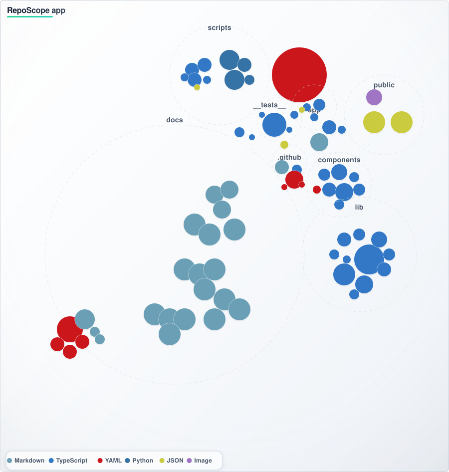

# RepoScope 🛡️

> **DataOps & Industrial Code Quality Gatekeeper**  
> Automated health-audit engine for public repositories, targeting Data Science, Analytics Engineering, and Industrial IoT (IIoT) pipelines.

<p align="center">
  <a href="https://github.com/esmaeilireza/RepoScope/actions/workflows/ci.yml">
    
  </a>
  <a href="https://reposcope-ochre.vercel.app/">
    
  </a>
</p>

<p align="center">
  
  
  
  
  <a href="https://opensource.org/licenses/MIT">
    
  </a>
</p>

## 📖 Overview

RepoScope is an automated health-audit engine customized specifically for **Data Science, Analytics Engineering, and Industrial IoT (IIoT)** pipelines. It ensures codebases running critical models, SCADA integration logic, and Python microservices maintain production-grade compliance before merging.

Coming from an industrial automation and PLC background where runtime failure is not an option, I built RepoScope to bring deterministic health checks into data analytics and software workflows. Ambiguity in code readiness, broken pipelines, and unverified data references cause silent downstream failures. RepoScope automates repository integrity verification before code reaches production.

It doesn't just give you a score—it explains exactly **why** the health score is what it is, with actionable fixes.

---

## 📊 Implementation Status (Oct 2026)

**Honest Engineering:** 22 of 47 YAML rules currently fire in the audit engine. The remaining 25 are marked `status: draft` in `docs/specs/*.yaml` (declared as roadmap, not yet wired to checks). This gap is strictly enforced by our test suite (`test_active_rules_are_all_implemented_in_typescript`).

| Domain | Active Rules | Draft Rules |
|---|---|---|
| General (WebApp baseline) | 14 | 0 |
| DataOps | 5 | 19 |
| IIoT | 4 | 2 |
| Cross-Domain | 0 | 2 |
| WebApp | 0 | 2 |

**The CLI Gate:** `npx --no-install reposcope --repo <path> [--strict]` exits non-zero on violations. This is the "gate" — a deterministic rule set that returns a signal your CI can act on, replacing manual audit checklists with executable YAML manifests.

---

## ✨ Features

- **📊 DataOps Compliance Check** — Validates notebook clean-state, large dataset leakages, deterministic dependency resolution (Poetry/Pipfile/Conda-lock), and dbt schema tests.
- **⚙️ Deterministic Testing & IIoT Mock Integrity** — Verifies CI/CD pipelines for mock validation protocols (Modbus/SCADA simulations, OOM detection, pytest assertions).
- **🧭 Comprehensive Repository Audit** — Section-by-section evaluation mirroring GitHub's navigation (Code, Issues, PRs, Actions, Security, and more).
- **📝 Smart README Link Checker** — A heuristic-based classifier that validates every Markdown link, image, and relative path; intelligently skips external URLs, API endpoints, HTML tags, and placeholders.
- **🧠 Knowledge-Grounded AI (GraphRAG)** — AI insights are grounded in a structured knowledge graph (`public/knowledge/graph.json`). A **Citation Gate** strips any LLM claim referencing a page or author unless it exists in the canonical book/standard registry.
- **🤖 AI-Powered Actions Diagnostics** — Analyzes failed GitHub Actions runs, identifies root causes (data pipeline, OT driver, web build), and provides one-click fix commands.
- **🔐 Secure GitHub Proxy & BYOK** — All AI requests go through a Next.js API route with rate limiting. Supports Bring Your Own Key (BYOK) for 12+ providers (Groq, Google, OpenAI, Anthropic, etc.).

---

## 🎯 Audit Profiles

RepoScope supports three specialized audit profiles, each with tailored rules and scoring weights:

| Profile | Target Use Case | Key Checks | Active Tabs |
|---------|-----------------|------------|-------------|
| **DataOps & Analytics** | Data science, dbt, analytics engineering | Notebook hygiene, DVC/LFS tracking, lockfile presence, dbt tests | Findings, Data Pipeline, Tree, README |
| **Industrial / PLC (IIoT)** | SCADA, Modbus, OT systems | Mock server integrity, deterministic execution, driver tests | Findings, IIoT / PLC, Tree, README |
| **General Web App** | Standard web projects | CI/CD, README, deployment, dependencies | Findings, Tree, README |

---

## 🚀 Getting Started

### Prerequisites
- Node.js 18+ (Node.js 20+ recommended)
- pnpm 8+ (or npm/yarn)
- Python 3.9+ (for knowledge graph and spec building)

### Installation & Local Development

```bash
# Clone the repository
git clone https://github.com/esmaeilireza/RepoScope.git
cd RepoScope

# Deterministic install
pnpm install --frozen-lockfile

# Start development server
pnpm dev
```

Open [http://localhost:3000](http://localhost:3000), paste any GitHub repository URL (e.g., `https://github.com/vercel/next.js`), select an **Audit Profile**, and click **Analyze Repository**.

### CLI Usage

Run the deterministic audit engine directly in your terminal to act as a CI gate:

```bash
# Run the CLI (using local installation)
npx --no-install reposcope --repo . --strict

# Or run the full audit suite locally (TypeScript, Lint, Build)
pnpm audit:all
```

### Quality & Audit Scripts

```bash
pnpm typecheck          # Run TypeScript compiler (0 errors)
pnpm build              # Production build + builds specs.json
pnpm lint               # Run ESLint
python scripts/verify_claims.py    # Verify all public claims against the codebase
pnpm verify:registry    # Verify knowledge graph integrity
```

---

## 🧠 Knowledge-Grounded AI & Citation Gate

RepoScope avoids LLM hallucinations by using a **GraphRAG** architecture instead of standard vector embeddings. 

1. **Graph Construction:** PDFs are processed via Ollama (`qwen2.5:7b`) to extract concepts and build `public/knowledge/graph.json`.
2. **Context Assembly:** Findings are mapped to YAML rules, which map to concepts, which map to the exact book chapter.
3. **Citation Gate (`lib/knowledge/citation-gate.ts`):** Before the AI response is shown to the user, it is scanned. Any sentence containing "page 42" or "according to [Author]" that *does not* also cite a known book from `lib/knowledge/books.ts` is stripped and replaced with `[source unverified]`.

You can read more about this in the [Methodology ADR](docs/methodology.md) and the [Knowledge Index](docs/knowledge-index.md).

---

## 🔑 GitHub Token & AI BYOK (Optional)

RepoScope works **without a token** for public repositories (60 requests/hour limit). For higher limits or private repositories:

1. Create a `.env` file in the project root:
   ```env
   GITHUB_TOKEN=ghp_your_token_here
   DEFAULT_AI_PROVIDER=groq
   GROQ_API_KEY=gsk_your_key_here
   ```
2. Or use the **Advanced Settings** section in the UI to provide a token or AI key per-session (BYOK). The token is sent only to the local proxy and never stored.

| Mode | GitHub Requests/Hour | AI Requests/Day |
|------|----------------------|-----------------|
| Without token (Server default) | 60 | 5 (rate-limited) |
| With token / BYOK | 5,000 | Unlimited (you pay provider) |

---

## 🧭 What Gets Audited

### Repository Health Checks
Includes presence and quality of README, LICENSE, CI/CD workflows, Tests, SECURITY.md, CONTRIBUTING.md, CHANGELOG.md, .editorconfig, and Dependabot config. It also checks for stale branches, open PRs, and open issues.

### DataOps & IIoT Specific Checks

| Category | What is Checked |
|----------|-----------------|
| **Data Leakage** | Raw `.csv`, `.parquet`, `.db`, `.pkl` files tracked without DVC/Git-LFS |
| **Environment Parity** | Presence of `poetry.lock`, `Pipfile.lock`, `requirements.lock`, `conda-lock.yml` |
| **Notebook Hygiene** | Out-of-order cell execution, bloated output cells (>200KB) |
| **Industrial Mocks** | Modbus/SCADA mock server configuration, connection error patterns |
| **Memory Safety** | OOM patterns (`MemoryError`, exit code 137, CUDA OOM) |

### README Link Validation (Heuristic-Based)
The audit engine uses a stable heuristic classifier to validate README links:
- **External URLs** (`github.com`, `arxiv.org`): ✅ Skipped.
- **File Paths** (`src/app.py`, `backend/weights/model.pt`): ✅ Validated against repo tree.
- **HTML Tags** (`/td`, `/table`): ✅ Skipped (not links).
- **API Endpoints** (`/predict`, `/chat`): ⚠️ Flagged as suspicious.
- **Placeholders/Dates/Hex Colors**: ✅ Skipped.

---

## 🧮 Health Score Calculation

$$\text{Score} = 100 - \left( 20 \times \text{Critical} + 15 \times \text{Error} + 10 \times \text{Warning} + 2 \times \text{Info} \right)$$

| Severity | Weight | Examples |
|----------|--------|----------|
| **Critical** | -20 pts | No README, No LICENSE, Unmanaged raw datasets |
| **Error** | -15 pts | No CI/CD, No tests, Loose dependency specs |
| **Warning** | -10 pts | No SECURITY.md, >15 open PRs, Notebook hygiene issues |
| **Info** | -2 pts | No Dependabot, No CONTRIBUTING, No CHANGELOG |

Every deduction appears in the **"Why this score?"** panel along with its probable cause and a concrete fix suggestion.

---

## 🛠️ Tech Stack

| Category | Technology |
|----------|------------|
| **Framework** | Next.js 14 (App Router) |
| **Language** | TypeScript 5, Python 3 (KG Pipeline) |
| **UI** | React 18, Tailwind CSS 3.4 |
| **API** | GitHub REST API v3, Ollama (Local), 12+ LLM Providers |
| **Package Manager** | pnpm 9 |
| **CI/CD** | GitHub Actions |
| **Deployment** | Vercel |

---

## 📂 Project Structure

<div align="center">
  
</div>

<details>
<summary><b>Click to expand the full text directory tree</b></summary>

```text
── 📁 my-reposcope-app
    ├── 📁 __tests__
    │   ├── 🔷 audit.test.ts
    │   ├── 🔷 graph-grounding.test.ts
    │   ├── 🔷 graph-spec.test.ts
    │   ├── 🔷 llm-layer.test.ts
    │   ├── 🔷 specs.test.ts
    │   └── 📄 test_specs.py
    ├── 📁 app
    │   ├── 📁 api
    │   │   ├── 📁 github
    │   │   │   └── 🔷 route.ts
    │   │   └── 📁 insight
    │   │       └── 🔷 route.ts
    │   ├── 🎨 globals.css
    │   ├── 📄 icon.tsx
    │   ├── 📄 layout.tsx
    │   ├── 📄 page.tsx
    │   └── 🔷 sitemap.ts
    ├── 📁 bin
    │   └── 📄 reposcope
    ├── 📁 components
    │   ├── 📁 ui
    │   │   └── 📄 Card.tsx
    │   ├── 📄 ActionsDashboard.tsx
    │   ├── 📄 ActionsPanel.tsx
    │   ├── 📄 AIInsight.tsx
    │   ├── 📄 AuditTabs.tsx
    │   ├── 📄 Board.tsx
    │   ├── 📄 CommandBlock.tsx
    │   ├── 📄 ErrorCard.tsx
    │   ├── 📄 ExportButtons.tsx
    │   ├── 📄 RepoInput.tsx
    │   ├── 📄 ScoreBoard.tsx
    │   ├── 📄 SmartDiagnosis.tsx
    │   ├── 📄 StatusBadge.tsx
    │   └── 📄 TokenInput.tsx
    ├── 📁 docs
    │   ├── 📁 checklists
    │   │   ├── 📝 cross.md
    │   │   ├── 📝 dataops.md
    │   │   ├── 📝 general.md
    │   │   ├── 📝 iiot.md
    │   │   └── 📝 webapp.md
    │   ├── 📁 notes
    │   │   ├── 📁 dataops
    │   │   │   ├── 📝 analytics-engineering-with-sql-and-dbt.md
    │   │   │   ├── 📝 data-management-at-scale.md
    │   │   │   ├── 📝 data-quality-fundamentals.md
    │   │   │   ├── 📝 designing-data-intensive-applications.md
    │   │   │   ├── 📝 fundamentals-of-data-engineering.md
    │   │   │   ├── 📝 practical-dataops.md
    │   │   │   └── 📝 the-data-warehouse-toolkit.md
    │   │   ├── 📁 graph-rag
    │   │   │   ├── 📝 agentic-graphrag.md
    │   │   │   ├── 📝 essential-graphrag.md
    │   │   │   ├── 📝 graph-algorithms.md
    │   │   │   ├── 📝 graph-databases.md
    │   │   │   └── 📝 graph-powered-machine-learning.md
    │   │   ├── 📁 iiot
    │   │   │   ├── 📝 automating-manufacturing-systems-with-plcs.md
    │   │   │   ├── 📝 industrial-network-security.md
    │   │   │   ├── 📝 opc-unified-architecture.md
    │   │   │   ├── 📝 plc-controls-with-structured-text.md
    │   │   │   └── 📝 practical-industrial-data-networks.md
    │   │   ├── 📁 industrial-ml
    │   │   │   ├── 📁 01-realtime-streams
    │   │   │   ├── 📁 02-iiot-edge-digital-twins
    │   │   │   ├── 📁 03-time-series-sensor-analytics
    │   │   │   └── 📁 04-industrial-mlops
    │   │   └── 📁 webapp
    │   │       ├── 📝 api-design-patterns.md
    │   │       ├── 📝 building-microservices.md
    │   │       ├── 📝 clean-architecture.md
    │   │       ├── 📝 continuous-delivery.md
    │   │       ├── 📝 designing-web-apis.md
    │   │       ├── 📝 production-ready-microservices.md
    │   │       ├── 📝 site-reliability-engineering.md
    │   │       ├── 📝 the-devops-handbook.md
    │   │       └── 📝 web-application-security.md
    │   ├── 📁 specs
    │   │   ├── 📄 _graph.yaml
    │   │   ├── 📄 _schema.yaml
    │   │   ├── 📄 cross.yaml
    │   │   ├── 📄 dataops.yaml
    │   │   ├── 📄 general.yaml
    │   │   ├── 📄 iiot.yaml
    │   │   └── 📄 webapp.yaml
    │   ├── 📝 attribution.md
    │   ├── 📝 audit-use-cases.md
    │   ├── 📄 claims.yaml
    │   ├── 📝 knowledge-index.md
    │   ├── 📝 methodology.md
    │   └── 📝 token-handling.md
    ├── 📁 hooks
    │   ├── 🔷 useAIDiagnosis.ts
    │   └── 🔷 useGitHubActions.ts
    ├── 📁 lib
    │   ├── 📁 knowledge
    │   │   ├── 🔷 books.ts
    │   │   ├── 🔷 citation-gate.ts
    │   │   ├── 🔷 graph.ts
    │   │   └── 🔷 standards.ts
    │   ├── 📁 llm
    │   │   ├── 🔷 adapters.ts
    │   │   ├── 🔷 client.ts
    │   │   └── 🔷 providers.ts
    │   ├── 🔷 anomaly-detector.ts
    │   ├── 🔷 audit.ts
    │   ├── 🔷 config.ts
    │   ├── 🔷 dataops-audit.ts
    │   ├── 🔷 environment-parity.ts
    │   ├── 🔷 export.ts
    │   ├── 🔷 github-auto-fix.ts
    │   ├── 🔷 github-diagnostics.ts
    │   ├── 🔷 github-error-patterns.ts
    │   ├── 🔷 github-health-monitor.ts
    │   ├── 🔷 github-log-parser.ts
    │   ├── 🔷 github.ts
    │   ├── 🔷 iiot-audit.ts
    │   ├── 🔷 insight.ts
    │   ├── 🔷 link-classifier.ts
    │   ├── 🔷 rate-limiter.ts
    │   ├── 🔷 sbom-generator.ts
    │   ├── 🔷 types.ts
    │   └── 🔷 utils.ts
    ├── 📁 public
    │   ├── 📁 knowledge
    │   │   ├── 📋 graph.json
    │   │   └── 📋 specs.json
    │   ├── 🌐 googlea4e112c226b2506e.html
    │   ├── 📄 og-image.png
    │   ├── 📄 robots.txt
    │   └── 📄 site.webmanifest
    ├── 📁 scripts
    │   ├── 📁 kg
    │   │   ├── 📄 __init__.py
    │   │   ├── 📋 aliases.json
    │   │   ├── 📄 assemble_graph.py
    │   │   ├── 📄 extract.py
    │   │   ├── 📝 knowledge-index.md
    │   │   ├── 📄 neo4j_export.py
    │   │   ├── 📄 neo4j_import.py
    │   │   ├── 📄 neo4j_validate.py
    │   │   ├── 📝 README.md
    │   │   ├── 📄 route_knowledge.py
    │   │   └── 📄 validate_graph.py
    │   ├── 📄 build_knowledge.py
    │   ├── 📄 check-structure.mjs
    │   ├── 📄 diagnose.py
    │   ├── 📄 evaluate_claims.py
    │   ├── 📄 fix_notes_metadata.py
    │   ├── 📄 generate-sbom.mjs
    │   ├── 📄 render_checklists.py
    │   ├── 🔷 reposcope-audit.ts
    │   ├── 📄 verify_claims.py
    │   └── 🔷 verify-knowledge-registry.ts
    ├── 📝 CHANGELOG.md
    ├── 📝 CONTRIBUTING.md
    ├── 📄 eslint.config.mjs
    ├── 📋 graph.json
    ├── 📄 LICENSE
    ├── 🔷 next-env.d.ts
    ├── 🟨 next.config.js
    ├── 📋 package.json
    ├── 📄 pnpm-lock.yaml
    ├── 📄 pnpm-workspace.yaml
    ├── 🟨 postcss.config.js
    ├── 📄 pytest.ini
    ├── 📝 README.md
    ├── 📝 SECURITY.md
    ├── 📄 setup.sh
    ├── 🔷 tailwind.config.ts
    └── 📋 tsconfig.json
```

</details>

---

## 🤝 Contributing

Contributions are welcome! Please read [CONTRIBUTING.md](CONTRIBUTING.md) for guidelines.

**Good First Issues:**
- Video production & walkthroughs
- Technical writing & UX documentation
- DataOps rule expansion (dbt, Great Expectations, Pandera)
- Industrial protocol mocking (Modbus, OPC-UA, MQTT)

---

## 📄 License & Security

- This project is licensed under the MIT License — see the [LICENSE](LICENSE) file for details.
- For security issues, please read [SECURITY.md](SECURITY.md) for responsible disclosure guidelines.

---

<div align="center">

**Built with ❤️ by [Reza Esmaeili](https://github.com/esmaeilireza) and [Abbas Lotfi](https://github.com/abbas-pt)**

*RepoScope — Bringing industrial-grade deterministic quality gates to DataOps, IIoT, and modern software pipelines.*

</div>


```
